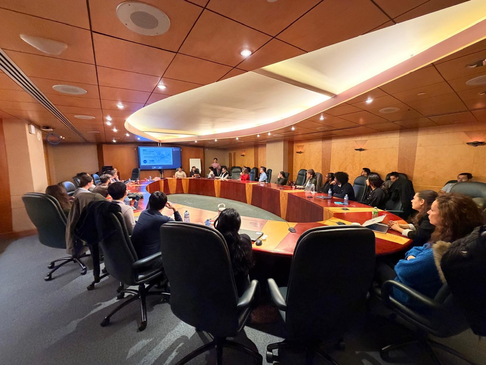
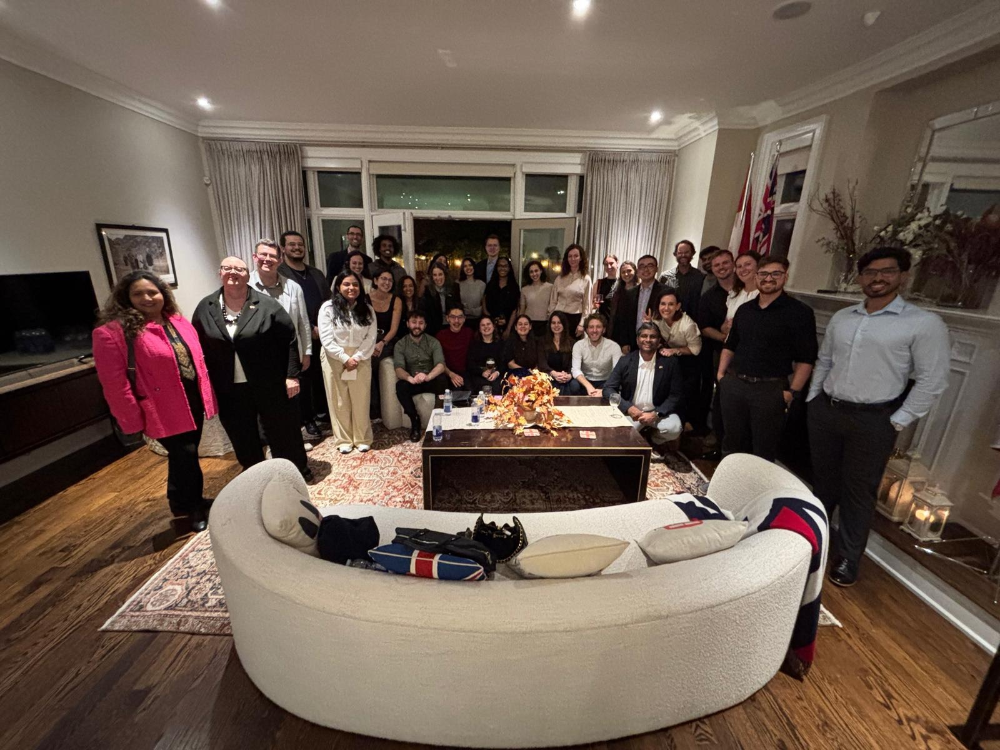
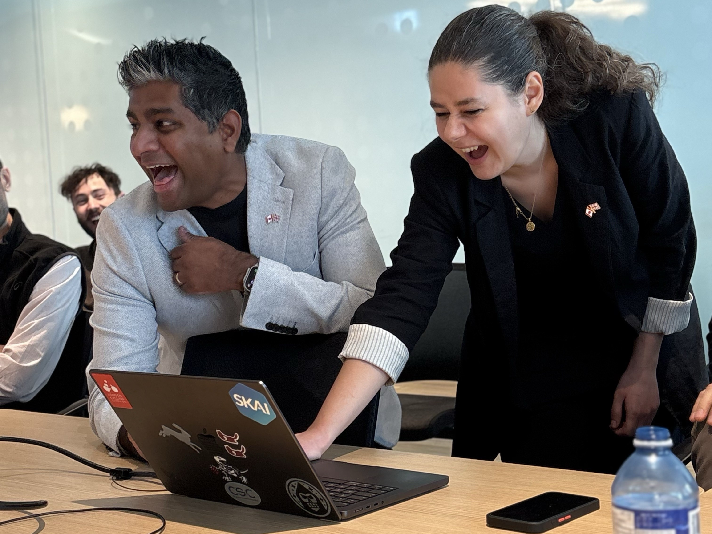
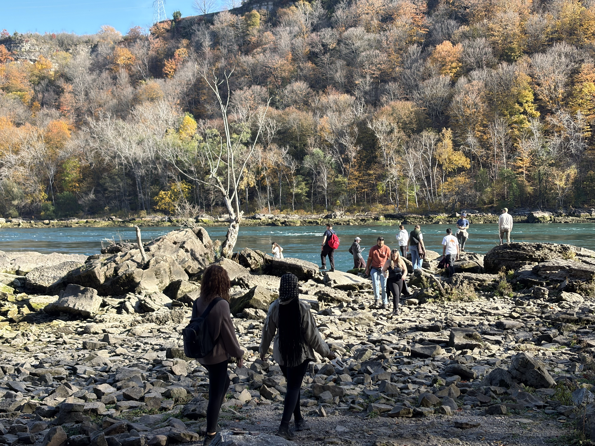

_Featured Image: A group photo taken on GSTT CSC’s visit to Toronto, during which the team strengthened their partnership with SickKids Artificial Intelligence._

The Clinical Scientific Computing (CSC) team at Guy’s and St Thomas’ (GSTT) had the pleasure of being hosted by the [SickKids Artificial Intelligence (SKAI)](https://www.sickkids.ca/en/about/sickkids-artificial-intelligence/) team for a three-day workshop in Toronto, which brought together colleagues from both organisations to exchange ideas on how to safely deploy and scale AI in healthcare and explore strategies to overcome existing barriers.

SKAI is the AI programme at The Hospital for Sick Children in Toronto (SickKids) that explores real problems in clinical workflows and identifies opportunities for AI solutions to be feasibly and safely implemented. Our visit was an opportunity for both teams to learn from one another, showcase our respective projects, and build stronger collaborative relationships, with the goal of signing an agreement that would enable us to exchange models.

As a new Trainee Clinical Scientist in GSTT CSC, I approached this experience with the intention of expanding my professional network whilst absorbing as much knowledge as I possibly could. I was exposed to interesting conversations around strategy, ethics, and technical considerations, gaining valuable perspectives that will continue to inspire me as I navigate my own learning journey.

**Day 1**
<figure>

<figcaption>In the SKAI boardroom.</figcaption>
</figure>

[Devin Singh](https://www.linkedin.com/in/drdevsk/), SKAI Service Co-Lead, kicked off the first day with an overview of the SKAI pillars, AI use cases in their paediatric emergency department, and potential roadblocks to deployment. Through the pillars, SKAI has demonstrated what components are needed in a successful AI programme: a discovery and research arm to capture and prioritise new projects; a deployment arm to assess current workflows and consider feasibility; and a community element focused on education and AI literacy, which encourages uptake while feeding back into discovery as more clinicians learn how AI can be integrated into their workflows.

In the afternoon, the teams explored specific use cases at both organisations. Many ethical considerations were discussed. One particularly interesting discussion centred on data drift and declining model performance, and what this means for the governance of software as a medical device (SaMD). Ethics was a recurring theme during the three-day workshop.

The Epic Sepsis Model (ESM) provides a good example of a model that performed well on a training dataset but failed on real data in clinical practice. The model was marketed by the developer at an AUC of 0.76–0.83. However, an external validation study showed that it operated at a considerably poorer AUC of 0.63, with a positive predictive value of 12%.1 Rather than relieving staff workload, it added to it. Due to the proprietary nature of the model, it was difficult to understand the reasons for the model errors.

An important lesson I took away from these discussions is that post-deployment surveillance, using a dashboard, is needed to continuously monitor and respond to changes in model performance. This helps us to keep AI models safe and fair for our patients.

**Day 2**
<figure>

<figcaption>Visiting the home of the British Consul General to Toronto.</figcaption>
</figure>

Head of Clinical Scientific Computing, [Dika Vilić](/team_member/dika.html), introduced day two with an overview of our key streams of work, including in-house AI development, our [quality management system](/blogs/articles/news/2026/01/01/QMS_press_release.html), and the deployment of SaMD. This provided me, as a new member of the team, with a fantastic opportunity to learn more about our own work—in particular, how we have got to where we are, and the challenges and opportunities that lie ahead.

I heard many interesting points regarding which AI solutions, with experience, were ultimately deemed to be less than useful. Sometimes single solutions are developed for singular problems. Sometimes solutions deliver non-actionable insights. Sometimes their implementation costs more than employing more staff.

Challenges were highlighted for the future. Our focus was strategy: how can we build an infrastructure, similar to the SKAI pillars, that would help support the development and deployment of AI at GSTT?

Together, the teams then discussed different approaches to AI education. An important takeaway was understanding why patient education is an important part of good governance.

During these discussions, thorny issues around patient consent were considered. Obtaining explicit consent is difficult because the patient must be informed at the point of collection of the intended use of the data, which is often not possible with secondary processing for AI research. But, in the NHS, patients must be given an option to opt out of research. And although explicit consent from patients for the use of their data may not be legally required,2 an institution with moral integrity should recognise the importance of transparency and incorporate this into its educational programmes.

That evening, teams from both organisations were kindly welcomed into the home of the British Consul General to Toronto, [Fouzia Younis MBE](https://www.linkedin.com/in/fouzia-younis-7591781b6/), who had [previously visited us](/blogs/articles/news/2026/06/09/British_Consul_General_visit.html), to celebrate the historic signing of the agreement between GSTT and SickKids. This agreement enables us to securely exchange models in order to test them on local data, marking a significant step towards strengthening international collaboration and enabling both organisations to learn from one another and build on shared expertise.

**Day 3**
<figure>

<figcaption>Running a SKAI model on GSTT data: a success story. Though Devin Singh and Dika Vilić nearly hit the wrong button.</figcaption>
</figure>

The final day began with the technical teams testing a SKAI model on GSTT data. As a new member of GSTT CSC, I found it almost surreal to be involved in this workshop, observing the model’s first run and seeing it generate results.

Overall, the workshop was a fantastic opportunity to gain a deeper understanding of my team’s history, our current workstreams, and future challenges, as well as how other international AI teams operate and the wealth of knowledge that can be shared through collaboration. 

Before the trip, a colleague had referred to it as a ‘baptism of fire’, and it was that and more! I may have underestimated just how much new information I would be exposed to in such a short space of time, but every bit of the experience was incredibly rewarding. From exploring new ideas and concepts to being welcomed so warmly into the GSTT CSC team, I came away with a much broader understanding of the breadth of work involved in advancing AI in healthcare. The experience has left me feeling inspired and motivated as I begin an amazing three-year journey of learning and professional growth.

<figure>

<figcaption>Members of the GSTT CSC team went hiking together when the workshop was over.</figcaption>
</figure>

_Follow us on [LinkedIn](https://www.linkedin.com/company/gstt-csc/) for more updates on GSTT CSC activities._

<small>1 Wong A, Otles E, Donnelly JP, et al. External Validation of a Widely Implemented Proprietary Sepsis Prediction Model in Hospitalized Patients. _JAMA Intern Med_. 2021;181(8):1065–1070. doi:10.1001/jamainternmed.2021.2626</small> 
<small>2 There are circumstances in which alternative legal bases and exceptions for processing special category data may apply, including those set out under Article 6 and Article 9(2) of the UK GDPR.</small>